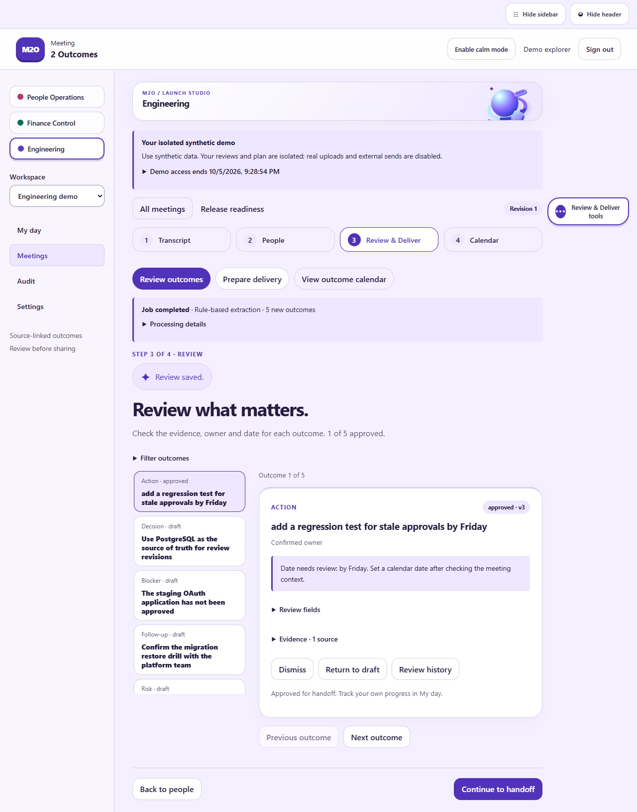
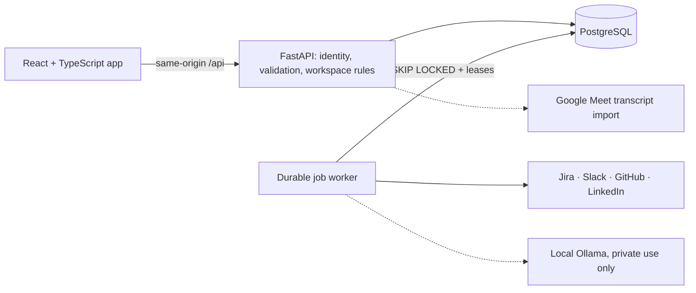
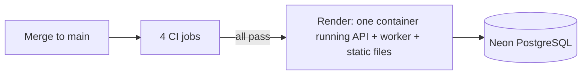
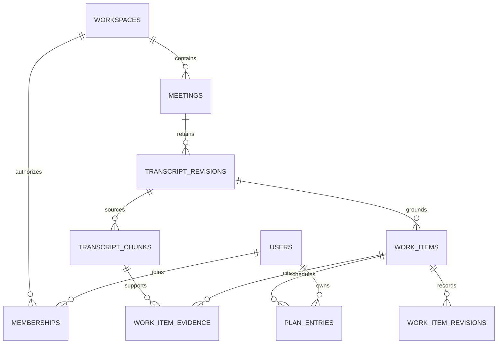
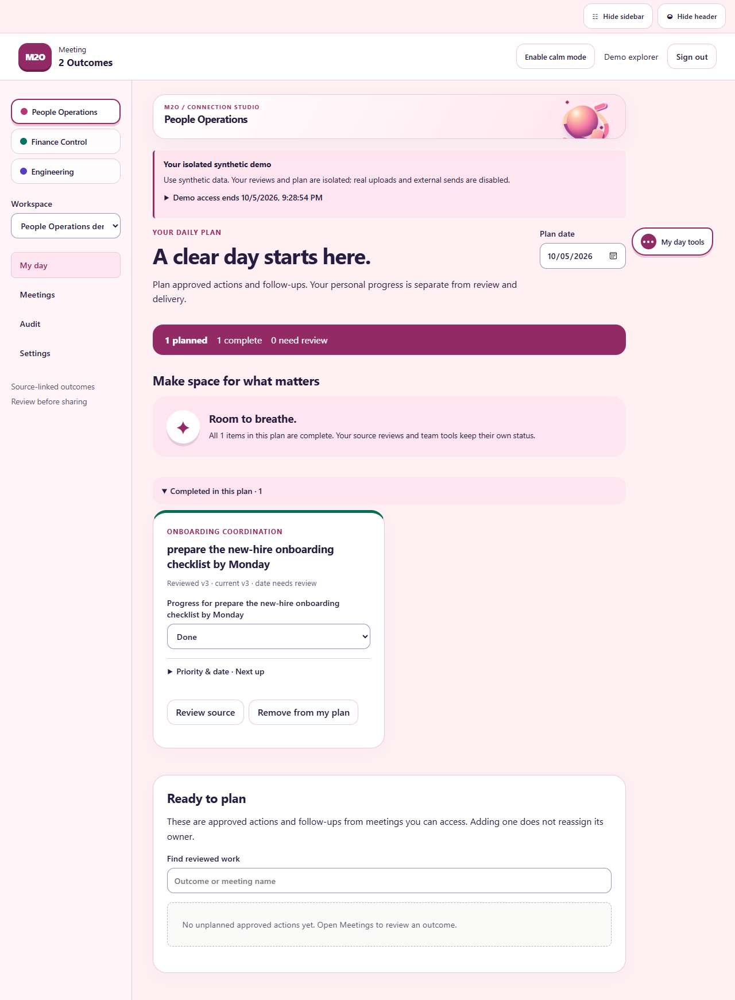
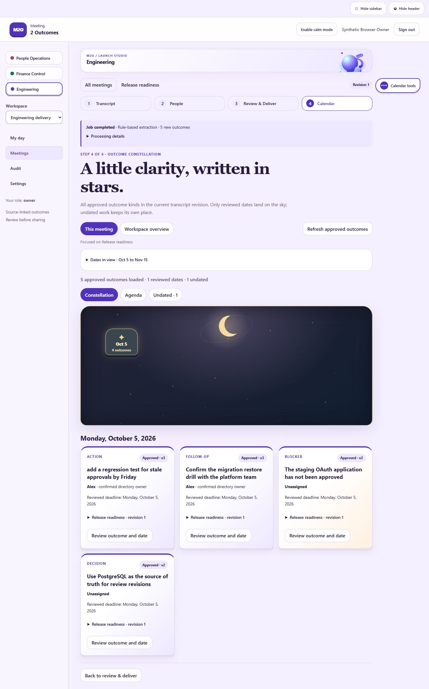

# M2O · Meeting 2 Outcomes

[](https://github.com/hs14235/M2O/actions/workflows/verify.yml)
[](https://m2o-synthetic-demo.onrender.com)

**Leave the meeting with a clear next step.** M2O turns meeting transcripts into source-linked actions, decisions, blockers, follow-ups and risks. People confirm who is involved, review each outcome, plan their day and approve an exact handoff to Jira, Slack, GitHub or LinkedIn.

**▶ Try it: [m2o-synthetic-demo.onrender.com](https://m2o-synthetic-demo.onrender.com)**. Choose *Explore the isolated demo*; each visitor gets private synthetic workspaces. The demo runs on a free tier, so the first visit after 15 idle minutes takes about a minute to wake up.

[](docs/media/visitor-engineering-review.png)

**Stack:** React + TypeScript · FastAPI · PostgreSQL + Alembic · a durable job worker · Docker · GitHub Actions · Render + Neon · optional local Ollama

## Engineering highlights

| What | Why it matters | Proof |
| --- | --- | --- |
| **Durable PostgreSQL job queue.** Claims use `FOR UPDATE SKIP LOCKED`, leases renew every 20 s and expire after 90 s, retries are capped, and the worker rechecks authority before every side effect. | Background work survives crashes without double-processing, and a revoked user's queued job can never act. | [`worker.py`](backend/app/worker.py) · crash-drill test in [`test_privacy.py`](backend/tests/test_privacy.py) |
| **Crash-safe erasure.** A worker that died mid-job with no lease was never reclaimed (`NULL < now()` never matches in SQL), so workspace erasure stayed pending forever. Found with a failing crash-drill test, then fixed. | Data-deletion promises hold even after crashes. | [PR #54](https://github.com/hs14235/M2O/pull/54) |
| **Exact approval and uncertain writes.** Delivery approval is bound to the exact previewed payload. A timeout after sending is recorded as *uncertain* and never blindly resent. | No duplicate tickets or messages, and no "approved A, sent B". | [`services/jira_delivery.py`](backend/app/services/jira_delivery.py) · [delivery rules](docs/JIRA_DELIVERY.md) |
| **Spoof-resistant rate limiting.** An explicit client-identity policy: forwarding headers are trusted only from configured proxies, trust-all ranges are rejected, and IPv6 clients are budgeted per /64. | Attackers can't forge `X-Forwarded-For` to dodge limits or lock out other users. | [`client_identity.py`](backend/app/client_identity.py) · [tests](backend/tests/test_client_identity.py) |
| **Safe migrations.** An advisory lock on a single connection with a timeout. The API and worker refuse to start against an unsupported schema. | Concurrent deploys can't race migrations, and old code never runs against a newer schema. | [`migrate.py`](backend/scripts/migrate.py) · [rollback policy](docs/OPERATIONS.md) |
| **Privacy by design.** Workspace erasure, retention previews before deletes, and aggregate-only diagnostics that never serialize transcripts, names or IDs. | Operators can inspect the system without seeing user data. | [`retention.py`](backend/app/services/retention.py) · [`diagnostics.py`](backend/app/services/diagnostics.py) |
| **Measured extraction quality.** An evaluation harness scores outcomes against 52 hand-labelled ones (precision, recall and F1 per kind, plus owner accuracy). Rule fixes raised F1 from 0.74 to 0.86 on that set. | Changes to extraction, including any local model, are judged by numbers on M2O's own cases, not by general benchmarks. | [Evaluation](docs/EXTRACTION_EVALUATION.md) |
| **Resilient frontend.** Stale responses are ignored, duplicate clicks blocked, and accepted saves recovered by reading state rather than resubmitting. | Flaky networks never cause duplicate writes. | [PR #56](https://github.com/hs14235/M2O/pull/56) |

## Quality gates

Every push and pull request runs four parallel CI jobs. `main` deploys to Render **only after all of them pass**.

| Job | What it proves (latest `main` run) |
| --- | --- |
| **backend** | Ruff, pyright, migrations with no model drift, **489 tests on PostgreSQL 17** (row locks, races and migrations included), dependency audit |
| **frontend** | TypeScript, **119 component tests**, production build, `npm audit` |
| **containers-and-browser** | Docker Compose stack plus **14 Playwright browser journeys** with axe accessibility checks. Five private-lifecycle journeys run locally against a disposable runtime. |
| **hosted-runtime** | Builds the production image, then checks it runs as non-root, sends security headers, isolates visitors, fails fast if the worker hangs, and keeps data across a restart |

Actions are pinned to commit SHAs. The live demo sends a strict CSP, HSTS, `nosniff` and `no-referrer`, and session cookies are `HttpOnly`, `Secure` and `SameSite=Lax`.

## Architecture



The API enforces identity, workspace permissions and versions. PostgreSQL holds transcripts, evidence, immutable review history, personal plans, connection grants and job/receipt state. A separate worker runs indexing, extraction and approved deliveries. Provider adapters own external protocols; services own product rules. This is a **modular monolith** by design: one database and one deployable unit are simpler to operate at this scale, and the queue lives in PostgreSQL instead of adding Redis.



<details>
<summary><b>How outcomes are generated</b></summary>

1. A bounded UTF-8 transcript is saved as a source revision, chunked, and queued for indexing.
2. The worker extracts candidates in bounded batches: deterministic explicit-label rules in the public demo, or structured output from local Ollama in private use.
3. Candidate kinds, fields and source references are validated. The response reports its mode, warnings and coverage instead of hiding a fallback.
4. Drafts are saved with evidence pointing at source chunks. People confirm participant matches and review each outcome; a model suggestion is never a confirmed owner or an approved task.
5. Approved outcomes appear in the calendar and the personal plan. External delivery needs a separate exact preview and approval; a queued job is not a provider receipt.

The five outcome kinds are **action, decision, blocker, follow-up and risk**. Relative phrases such as "next Friday" stay hints until a reviewer supplies a date.

</details>

<details>
<summary><b>Data model at a glance</b></summary>



Composite foreign keys keep workspace and source relationships consistent. Version checks and immutable review records stop a changed transcript or outcome from reusing an old approval. See [the full architecture](docs/ARCHITECTURE.md) and [the models](backend/app/models.py).

</details>

## Product walkthrough

| Step | What happens |
| --- | --- |
| **1 · Transcript** | Paste or upload a transcript in a private workspace, explore a synthetic demo, or import the latest Google Meet transcript after setup. |
| **2 · People** | Resolve ambiguous names against the workspace directory. A suggested match counts only after confirmation. |
| **3 · Review & Deliver** | Approve source-linked outcomes, then choose a destination and approve its exact preview. Review approval and delivery approval are separate actions. |
| **4 · Calendar** | See approved outcomes in a calendar or an accessible agenda; undated work stays visible. |

**My day** holds personal priorities and progress without changing review approval or external issue status. Three department experiences (Engineering, People Operations and Finance Control) share the same permission and review rules, each with its own examples and visual identity. Calm mode and the system reduced-motion setting turn off decorative motion.

<details>
<summary><b>More screenshots</b></summary>

| People Operations daily plan | Calendar |
| --- | --- |
| [](docs/media/visitor-hr-my-day.png) | [](docs/media/v2-calendar-desktop.png) |

Real browser captures from isolated synthetic workspaces using the real API and PostgreSQL worker. Also: [mobile people confirmation](docs/media/visitor-mobile-people.png), [mobile calendar](docs/media/v2-calendar-mobile.png), [calm mode](docs/media/v2-settings-mobile-calm.png).

</details>

## Team-tool connections

| Destination | Capability | Status | Setup |
| --- | --- | --- | --- |
| **Local handoff** | Download reviewed outcomes as Markdown or JSON | Works in the live demo | None |
| **Local transcription** | Turn a meeting recording into a transcript on the same machine (faster-whisper, int8, CPU); audio is deleted after use | Verified locally with the real model; off in the public demo | [Guide](docs/AUDIO_TRANSCRIPTION.md) |
| **Jira** | Discover issue types and fields, preview exact create/update content, approve queued delivery, inspect receipts | Contract-tested with synthetic provider responses | [Connection](docs/JIRA_CONNECTION.md) · [Delivery](docs/JIRA_DELIVERY.md) |
| **Slack** | Post or update messages; meeting actions use signed interaction requests | Contract-tested with synthetic provider responses | [Delivery](docs/SLACK_DELIVERY.md) · [Actions](docs/SLACK_ACTIONS.md) |
| **GitHub** | Deliver reviewed issues; detect duplicates, content conflicts and uncertain writes | Contract-tested with synthetic provider responses | [Guide](docs/GITHUB_DELIVERY.md) |
| **LinkedIn** | Own-profile connection and member-posting APIs; the publishing screen is pending | Contract-tested with synthetic provider responses | [Guide](docs/LINKEDIN_DELIVERY.md) |
| **Google Meet** | Read-only import of the latest existing transcript | Contract-tested with synthetic provider responses | [Guide](docs/GOOGLE_MEET_IMPORT.md) |

The public demo deliberately refuses to start if any provider credentials are configured, since anyone on the internet can use it. Live provider use runs in a private installation with your own approved apps.

## Run it locally

You need **Docker with Compose** and **Python 3.13**. Provider accounts and AI models are optional.

```powershell
python scripts/configure_local.py
docker compose up -d --build web worker
```

Open **[localhost:8080](http://localhost:8080)** and choose the synthetic demo. The configuration script writes ignored `.env` files with random local credentials and a per-checkout Compose project name. Use `docker compose stop` to pause; avoid `down -v` unless you mean to delete local data.

To create a private owner account (you'll be prompted for a password of 12+ characters):

```powershell
docker compose exec api python -m scripts.bootstrap --email owner@example.test --name "Local Owner"
```

[Native development, local AI and running the checks](docs/LOCAL_DEVELOPMENT.md)

## Documentation

- [Architecture and data integrity](docs/ARCHITECTURE.md) · [API contracts](docs/API.md) · [Security boundaries](docs/SECURITY.md)
- [Operations, migrations and rollback](docs/OPERATIONS.md) · [Hosted runtime](docs/HOSTED_DEMO_RUNTIME.md) · [User lifecycle and privacy](docs/USER_LIFECYCLE.md)
- [Verification record and known limits](docs/VALIDATION.md)

## Hosting

The public demo is **synthetic-only**: a Render free web service, Neon PostgreSQL in the same region, and deploys gated on CI. It sleeps when idle, and its data is disposable. Durable private use would need its own database, backup and recovery plan; see [the hosted runtime notes](docs/HOSTED_DEMO_RUNTIME.md).
