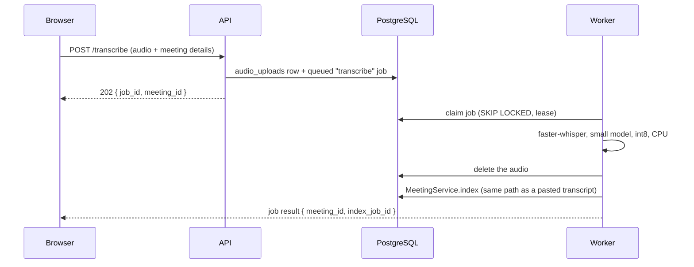

# Local audio transcription

M2O can turn an uploaded meeting recording into a transcript **on the same machine**, using [faster-whisper](https://github.com/SYSTRAN/faster-whisper) on CPU. The audio is never sent to a cloud service, and it is deleted as soon as transcription finishes.

Transcription is **off by default** and never available in the public demo, which forces `TRANSCRIPTION_ENABLED=false`. It is meant for private installations.

## Using it

When transcription is enabled, the Transcript step of a new meeting shows **Transcribe a recording**. The option is hidden otherwise, because the server reports `can_transcribe_audio` in `/api/me`. Choose an audio file and M2O queues it. The status line reads "Transcription running" and the meeting controls stay disabled until the job finishes. M2O then opens the new meeting, whose transcript is indexed like any other. Failures explain what to do next, for example that a recording is too long or contains no speech. The recording is never kept after a failure, so the fix is to upload it again.

## How it works



- **One path for every transcript.** The worker hands the text to `MeetingService.index`, so audio-derived meetings get the same role checks, size limits, chunking, revisioning and indexing as pasted ones.
- **The audio is held in PostgreSQL only until it is processed.** In Docker Compose the API and the worker run in separate containers, so a file on the API's disk would be invisible to the worker. The `audio_uploads` row is deleted once transcription succeeds or fails. It is also removed through a foreign key when the uploader's membership is revoked or the workspace is erased, and by retention maintenance after 24 hours if a job never finished.
- **Inference runs outside database transactions** and in a worker thread, so lease renewal continues during long jobs. If the worker crashes mid-transcription, the audio is kept and lease recovery retries the job.
- **Each upload creates a new meeting.** Replacing an existing transcript requires its current version, which a long-running job cannot hold safely.
- **Speakers are not identified.** The transcript has one line per spoken segment, without names. Confirm participants in the People step as usual.

## Limits and settings

| Setting | Default | Meaning |
| --- | --- | --- |
| `TRANSCRIPTION_ENABLED` | `false` | Turns on the `/transcribe` endpoint and worker job |
| `TRANSCRIPTION_MODEL` | `small` | Whisper model size (`base` is about 3× faster; see below) |
| `TRANSCRIPTION_COMPUTE_TYPE` | `int8` | Quantization; int8 keeps CPU and memory use low |
| `TRANSCRIPTION_MAX_SECONDS` | `3600` | Longest accepted recording (60 minutes) |
| `TRANSCRIPTION_MAX_BYTES` | `100000000` | Largest accepted upload (100 MB); prefer compressed formats |

Accepted formats are `.mp3`, `.m4a`, `.wav`, `.ogg`, `.webm`, `.flac` and `.mp4` (audio track). Uploads are limited to 10 per workspace per hour. If a worker heartbeat file is configured, raise `WORKER_JOB_DEADLINE` above the longest expected transcription time, or the health check will treat a long job as a hung worker.

## Enabling it

```powershell
cd backend
.venv\Scripts\python.exe -m pip install -r requirements-ai.txt
# then set TRANSCRIPTION_ENABLED=true in backend/.env and restart the API and worker
```

The first transcription downloads the chosen model from Hugging Face (`small` is about 0.5 GB) and caches it locally.

`requirements-ai.txt` pins `av==18.1.0` deliberately. faster-whisper 1.2.1 accepts any PyAV from 11 upward, but PyAV 19 removed an argument faster-whisper still passes, and transcription fails with `TypeError: open() got an unexpected keyword argument 'metadata_errors'`. This was found while measuring, and versions 15–18 were verified to work.

## Measured results

Measured on 2026-10-11 on the developer's Windows 11 laptop (CPU only), using `scripts/evaluate_transcription.py`. The recording is 31 seconds of a 73-word meeting script, synthesized with Windows' built-in offline voice so the exact words are known.

| Model (int8) | Transcription time | Real-time factor | Word error rate |
| --- | ---: | ---: | ---: |
| `small` | 12.2 s | 0.39 | 0.000 |
| `base` | 4.1 s | 0.13 | 0.000 |

The model loads in about 3 seconds once cached, once per worker process. At a real-time factor of 0.39, a 60-minute meeting would take roughly 24 minutes with `small` on this machine.

**What this does and does not show.** Clean synthetic speech with a single voice is a best case, and both models transcribe it perfectly, so this clip cannot tell their accuracy apart. Real meetings with accents, background noise and people talking over each other will have higher error rates, and that is where the larger model is expected to help. That expectation has not been measured here. The next step is a real recording read from the same script, scored with:

```powershell
python -m scripts.evaluate_transcription recording.m4a reference.txt --model small
```

## Tests

`backend/tests/test_transcription.py` replaces the model with a stub, so CI never downloads one. One opt-in test runs the **real** model end to end, through the queue and the worker, into a new meeting:

```powershell
$env:M2O_REAL_TRANSCRIPTION_AUDIO = "C:\recordings\meeting.wav"
python -m pytest tests/test_transcription.py -k real_model -s
```

It passed on 2026-10-11 with the synthetic recording above. The `small` model produced the expected transcript in about 15 seconds, including model load, and the audio was deleted afterwards.

## Licenses

faster-whisper and CTranslate2 are MIT. Their dependencies are MIT, Apache-2.0 or BSD, apart from tqdm (MPL-2.0, used unmodified). The Whisper model weights are MIT. Checked with `pip-licenses` in an isolated environment on 2026-10-11.
