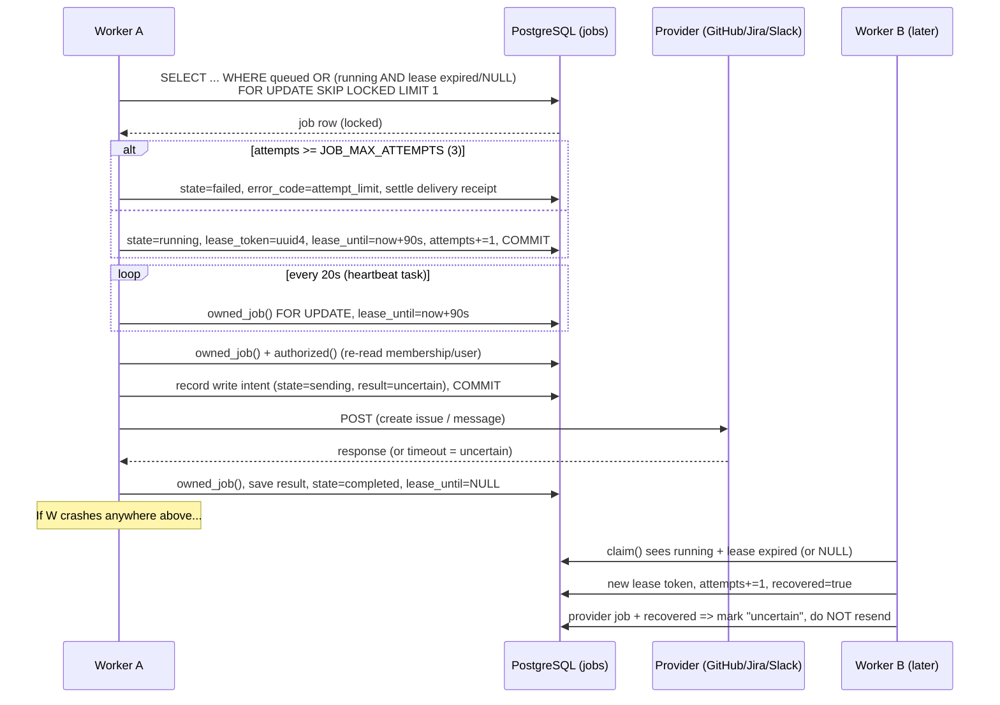

# 01 — Job claiming and leases

## In one sentence

M2O's background work lives in a PostgreSQL `jobs` table; a worker claims one row with `FOR UPDATE SKIP LOCKED`, stamps it with a random lease token that expires after 90 seconds, renews it every 20 seconds, and re-proves both the lease and the user's authority before every write, so a crashed worker's job can be reclaimed without ever repeating a provider write that may already have happened.

## The problem it solves

Indexing a transcript, extracting outcomes and publishing to GitHub/Jira/Slack/LinkedIn are slow or remote. They can't run inside the HTTP request, so they go on a queue. A queue has to answer four questions, and each wrong answer is a real bug:

1. **Who owns this job?** Two workers polling at once must not both pick the same row. Without row locking, both run the extraction and both write results, or both POST the same GitHub issue.
2. **What if the owner dies?** A worker killed mid-job (deploy, OOM, Render free instance sleeping) leaves the row in `running` forever. Nothing else will touch it, and anything waiting on it (workspace erasure, see guide 04) waits forever.
3. **What if a slow worker comes back?** A worker that paused longer than its lease may wake up after someone else reclaimed the job. If it can still write, you get two writers.
4. **What if the job is no longer allowed?** A job is queued by a user. Between queueing and running, the user may be demoted, deactivated, or the workspace may be frozen for erasure. Running the job anyway means acting on revoked authority.

And for provider writes there is a fifth: **if we crashed after sending a POST but before recording the answer, did the write happen?** You can't know. Sending it again might create a duplicate Jira issue or Slack message.

## Core flow



## Walk through the code

**1. The job row carries its own ownership state.** `backend/app/models.py:450`

```python
    attempts: Mapped[int] = mapped_column(Integer, default=0)
    lease_token: Mapped[str | None] = mapped_column(String(36))
    lease_until: Mapped[datetime | None] = mapped_column(DateTime(timezone=True))
    available_at: Mapped[datetime] = mapped_column(DateTime(timezone=True), default=now)
```

There is no separate broker. "Who owns the job" is just `lease_token`, "until when" is `lease_until`, and "how many times have we tried" is `attempts`. The limit is a module constant, `JOB_MAX_ATTEMPTS = 3` (`backend/app/models.py:423`), and the comment above it says diagnostics report against the same limit. A composite index `ix_job_claim` on `(state, available_at, created_at)` (`backend/app/models.py:437`) matches the claim query below.

**2. Claim: find a free row and lock it without waiting.** `backend/app/worker.py:102`

```python
                    (Job.state == "running") & or_(Job.lease_until.is_(None), Job.lease_until < now()),
                ),
                Job.available_at <= now(),
            )
            .order_by(Job.created_at)
            .with_for_update(skip_locked=True)
```

A row is claimable if it is `queued`, or if it is `running` but its owner is gone (lease expired or missing). `FOR UPDATE` locks the row for this transaction. `SKIP LOCKED` means: if another worker already locked that row, don't wait for it, just skip to the next candidate. That is what lets several workers poll the same table without blocking each other or double-claiming. `.limit(1)` (`backend/app/worker.py:108`) means one job per claim, oldest first.

The `Job.lease_until.is_(None)` branch is the NULL-lease fix. Before commit `2a95950` the condition was only `Job.lease_until < now()`. In SQL, `NULL < now()` is not true or false; it is *unknown*, and a `WHERE` clause only keeps rows where the condition is true. So a `running` row with a NULL lease could never be reclaimed by any worker. The comment at `backend/app/worker.py:99` records this. The current code never writes `running` with a NULL lease itself (every claim sets one), but such a row can still come from older code, manual edits or an imported/restored database, and diagnostics count it separately as `running_without_lease` (`backend/app/services/diagnostics.py:89`).

**3. Enforce the attempt limit, then take the lease.** `backend/app/worker.py:112`

```python
        if job.attempts >= JOB_MAX_ATTEMPTS:
            job.state, job.error_code = "failed", "attempt_limit"
            job.lease_until = None
            settle_exhausted_delivery(session, job)
            return None
```

and `backend/app/worker.py:117`:

```python
        recovered = job.state == "running"
        job.state, job.lease_token = "running", str(uuid4())
        job.lease_until = now() + timedelta(seconds=90)
        job.attempts += 1
```

A job that keeps crashing the worker (a "poison" job) would otherwise be reclaimed forever. After three claims it is marked `failed` with code `attempt_limit`. `settle_exhausted_delivery` (`backend/app/worker.py:47`) makes sure the provider receipt doesn't stay in a misleading state: if the operation was already `sending` or had an `uncertain` result it becomes `uncertain`, otherwise `failed`, with a `not_sent` explanation when there was no result at all.

Otherwise the worker writes a fresh random `lease_token`, sets the lease to 90 seconds from now, and bumps `attempts`. `recovered` is `True` if the row was already `running`, meaning a previous owner died. That flag is passed along in the claim record (`backend/app/worker.py:122`) and drives the "never resend" rule in step 6. The `session_scope()` commits on exit, which releases the row lock.

**4. Prove you still own the job before every write.** `backend/app/worker.py:125`

```python
def owned_job(session, claim_record):
    job = session.scalar(select(Job).where(Job.id == claim_record["id"]).with_for_update())
    if job is None or job.state != "running" or job.lease_token != claim_record["lease"]:
        raise ServiceError(status_code=409, error="Job lease is no longer owned")
    return job
```

This is the fencing check. Every phase that commits (`execute`, `publish`, `publish_jira`, `run_once`'s final save) begins with `owned_job`. If the lease expired and another worker reclaimed the row, it now has a different `lease_token`, so the old worker gets a 409 instead of writing. Because the check takes `FOR UPDATE`, nobody can reclaim the row between the check and this transaction's commit. The success path in `run_once` also goes through it (`backend/app/worker.py:500`), and the failure path only writes if the token still matches (`backend/app/worker.py:509`). A worker that lost its lease writes nothing.

**5. Heartbeat: keep the lease alive while working.** `backend/app/worker.py:169`

```python
async def heartbeat(record, runtime: WorkerPulse | None = None):
    while True:
        await asyncio.sleep(20)

        def renew():
            with session_scope() as session:
```

`run_once` starts this as a separate asyncio task (`backend/app/worker.py:496`). Every 20 seconds it calls `owned_job` and pushes `lease_until` to now + 90 s (`backend/app/worker.py:176`). So a healthy worker's lease never expires, and a dead one's expires at most 90 seconds after its last renewal, which is about four missed heartbeats. The renewal runs in a thread (`asyncio.to_thread`) because the database call is blocking. If renewal finds the lease gone, `owned_job` raises and the heartbeat task ends. The main work notices at its next `owned_job` call. The `finally` block cancels the heartbeat and swallows its `ServiceError` (`backend/app/worker.py:570`).

**6. Re-check authority, and never blindly retry an uncertain write.** `backend/app/worker.py:150`

```python
    if (
        not user_is_active(user)
        or not member
        or member.role not in allowed
        or user is None
        or user.auth_version != job.actor_auth_version
```

`authorized` re-reads the membership and user with `populate_existing=True` (`backend/app/worker.py:138`) so a cached ORM object from before an `await` can't hide a role change. It checks the role allowed for this job kind, the account's `auth_version` (bumped on password reset or account erasure), then `workspace_access` (`backend/app/worker.py:159`), which fails if the workspace is frozen for erasure.

For provider jobs, the worker commits "intent" before the network call, and a recovered job refuses to send. Jira, `backend/app/worker.py:296`:

```python
        if operation.state != "queued" or record["recovered"]:
            operation.state = "uncertain"
            operation.result = {
                "status": "uncertain",
                "error": "Recovered delivery requires reconciliation; no write repeated",
            }
```

Then, `backend/app/worker.py:303`: "Commit intent first. A crash from this point onward must never resend." The worker sets `state="sending"` with an `uncertain` result and commits before calling Jira. If it crashes after that, the next claim sees `recovered=True` (or state `sending`) and marks the delivery `uncertain` for a human to reconcile. GitHub is slightly different: it first searches for a marker in existing issues (`backend/app/worker.py:210`), but the comment at `backend/app/worker.py:211` explains why not finding it is still not proof that a second POST is safe. Slack mirrors Jira at `backend/app/worker.py:368`.

**7. Record failure only if you still own the lease.** `backend/app/worker.py:507`

```python
        with session_scope() as session:
            job = session.get(Job, record["id"])
            if job and job.lease_token == record["lease"]:
                job.state, job.error_code, job.lease_until = "failed", code, None
```

Any exception becomes a durable `failed` state with a safe error code: `service_<status>` for a `ServiceError`, otherwise the exception class name (`backend/app/worker.py:505`). Transcripts, SQL and credentials stay out of logs. Note this failure path is the *end* of the job: there is no automatic retry of a failed job. Automatic re-runs only happen via lease expiry (a crash), and those are bounded by the attempt limit.

**8. The crash drill proves the whole chain.** `backend/tests/test_privacy.py:239`

```python
@pytest.mark.parametrize("lease", ["expired", "missing"])
def test_worker_recovery_settles_crashed_job_so_erasure_completes(client, session, seeded, lease):
    # Drill: the worker died mid-job (lease lapsed or never recorded), then erasure was requested.
```

The test fakes a dead worker: state `running`, a token, and `lease_until` either one second in the past or NULL (`backend/tests/test_privacy.py:246`). Erasure is requested and returns 202 because a job is running. Then `run_once()` reclaims the job, `authorized` fails because the workspace is frozen, and the job is settled as `failed` with `service_404` and a NULL lease (`backend/tests/test_privacy.py:259`). A second `run_once()` returns `False`: nothing is left to claim. Finally erasure completes. The `"missing"` case is the regression test for the NULL-lease bug; with the old query that row would never be claimed and erasure would stay pending forever.

## What breaks without each piece

| Mechanism | Failure it prevents |
| --- | --- |
| `FOR UPDATE` on claim | Two workers read the same `queued` row and both run it. |
| `SKIP LOCKED` | Workers queue up behind one locked row instead of taking the next job; throughput collapses to one. |
| `lease_until` + reclaim of expired leases | A crashed worker's job stays `running` forever; erasure and users wait forever. |
| `lease_until IS NULL` branch | A `running` row with no lease is invisible to every claim (`NULL < now()` is unknown). |
| Random `lease_token` checked in `owned_job` | A slow worker that lost its lease overwrites the new owner's results. |
| 20 s heartbeat vs 90 s lease | Long jobs (model inference, provider calls) get reclaimed while still alive, causing duplicate work. |
| `JOB_MAX_ATTEMPTS = 3` | A job that crashes the worker is reclaimed in an infinite loop. |
| `authorized()` before side effects | A demoted user's or frozen workspace's job still publishes. |
| Intent committed before the network call | After a crash you can't tell "never sent" from "maybe sent". |
| `recovered` → `uncertain`, no resend | A crash after POST creates a duplicate issue or message on retry. |
| Failure path checks `lease_token` | A worker that lost its lease marks the new owner's job as failed. |

## Trade-offs and alternatives

**Postgres queue vs Redis/Celery/SQS.** The main win of a table queue is that job state commits in the same transaction as the domain data. Enqueueing an extraction and creating the transcript revision are one commit; marking a job complete and saving its results are one commit. With Redis or a broker you get the classic dual-write problem (DB committed, message lost, or the reverse) and need an outbox pattern to fix it. It is also one less service to run, which matters on Render's free tier. The costs: polling (`serve` sleeps 1 s when idle, `backend/app/worker.py:585`), extra load on the primary database, and lower throughput ceilings than a dedicated broker. For M2O's volume that is fine. You'd revisit if job volume grows enough that polling and row churn hurt the main database, or if you need fan-out, scheduling or priorities a broker gives for free.

**Lease vs holding a lock for the whole job.** You could hold the row lock for the whole job instead of using a lease. But that keeps a transaction (and a pooled connection) open during minutes of inference or an HTTP call, and a crashed process's lock only goes away when Postgres notices the dead connection. Leases let the transaction be short and make expiry explicit and testable.

**Choosing 20 s / 90 s.** The lease must be several heartbeats long so one slow renewal (GC pause, slow DB) doesn't lose ownership; 90/20 tolerates about four misses. A shorter lease recovers crashed jobs faster but risks false expiry; a longer one makes users and erasure wait longer after a crash. If renewals started failing under load you'd lengthen the lease; if crash recovery felt slow you'd shorten both proportionally. Note `now()` here is Python's clock (`backend/app/models.py:30`), not the database's, so the lease math assumes worker clocks are roughly in sync.

**Attempt limit of 3.** Enough to survive a deploy or a one-off crash, small enough to stop a poison job quickly. The cost is that a job hitting three unrelated crashes is failed for good and needs a human.

**At-least-once vs exactly-once.** Computation jobs (index, extract) are effectively at-least-once: they may run twice, which is safe because their writes are fenced by `owned_job`. Provider writes are at-most-once on purpose: after any doubt the system stops and asks a human, because an external duplicate can't be rolled back. An idempotency key accepted by the provider would let you retry safely, but you only get that if the provider supports it.

## Interview questions

**1. What does `SKIP LOCKED` do, and why does a queue need it?**

<details><summary>Answer</summary>

`SELECT ... FOR UPDATE SKIP LOCKED` locks the rows it returns, and if a candidate row is already locked by another transaction it skips it instead of waiting. In a queue, several workers poll at once. Without it, either they'd all block on the first locked row (`FOR UPDATE` alone), or without any lock they'd all read the same row and double-run it. With it, each worker gets a different row in one round trip.
</details>

**2. What is a lease, and why is a random token needed in addition to the expiry time?**

<details><summary>Answer</summary>

A lease is time-limited ownership: "this worker owns the job until `lease_until`". The expiry lets others reclaim a dead worker's job. The token is the fence: when a job is reclaimed it gets a new token, so the old worker, if it wakes up, fails the `owned_job` check (`lease_token != claim_record["lease"]`) and can't write. Expiry alone tells others when they may take over; the token stops the previous owner from acting after that.
</details>

**3. Why did a `running` job with `lease_until = NULL` never get reclaimed, and how was it fixed?**

<details><summary>Answer</summary>

SQL uses three-valued logic. Any comparison with NULL gives UNKNOWN, and `WHERE` keeps only rows where the condition is TRUE. So `lease_until < now()` excluded every NULL-lease row. The fix adds an explicit `lease_until IS NULL` branch (`backend/app/worker.py:102`), because a running job with no lease has no live owner. The crash-drill test is parametrized over `expired` and `missing` to keep both cases covered.
</details>

**4. The worker re-checks the user's role right before writing. Isn't checking at enqueue time enough?**

<details><summary>Answer</summary>

No. Time passes between enqueue and execution, and also between steps of one job (there are `await`s around provider calls). In that window an owner can demote the user, the user can reset their password (bumping `auth_version`), or the workspace can be frozen for erasure. `authorized` re-reads membership and user with `populate_existing=True` so a stale ORM identity-map object can't hide the change, then runs `workspace_access`. Checking at enqueue time is authorization for queueing, not for the side effect.
</details>

**5. A worker crashes right after sending a Jira create request. What happens next, step by step?**

<details><summary>Answer</summary>

Before the request, the worker committed `operation.state = "sending"` with an `uncertain` result. After the crash, the heartbeat stops, so within 90 s the lease expires. Another worker's `claim` finds the `running` row with an expired lease, gives it a new token, increments `attempts` and returns `recovered=True`. `publish_jira` sees `operation.state != "queued"` or `recovered` and marks the operation `uncertain` with "no write repeated", without calling Jira. A human reconciles. If the job had already used up three attempts, `claim` instead marks it `failed`/`attempt_limit` and `settle_exhausted_delivery` turns the `sending` operation into `uncertain`.
</details>

**6. How would you change this design if you needed safe automatic retries of provider writes and 100x the job volume?**

<details><summary>Answer</summary>

For retries: use provider idempotency keys where they exist (send a stable key per operation so a repeat is a no-op), or a pre-write marker plus a reliable read-after-write search, so "uncertain" can be resolved by the system. Without such support, at-most-once plus human reconciliation is still the honest choice. For volume: keep the transactional enqueue (outbox pattern) but move dispatch to a broker or a dedicated queue database; partition or index by state; replace 1 s polling with `LISTEN/NOTIFY` or broker push; and archive completed jobs so the claim index stays small. Re-tune lease and heartbeat times from measured job durations instead of the current fixed 90/20.
</details>

## Explain it back

1. In your own words, explain why M2O needs both `lease_until` *and* `lease_token`, using a concrete timeline of two workers and one slow network call.
2. Explain the NULL-lease bug to someone who has never heard of three-valued logic, and how you would have caught it earlier.
3. Defend the decision to mark crashed provider deliveries as `uncertain` and stop, rather than retrying. What would a product manager lose, and what would they gain?
