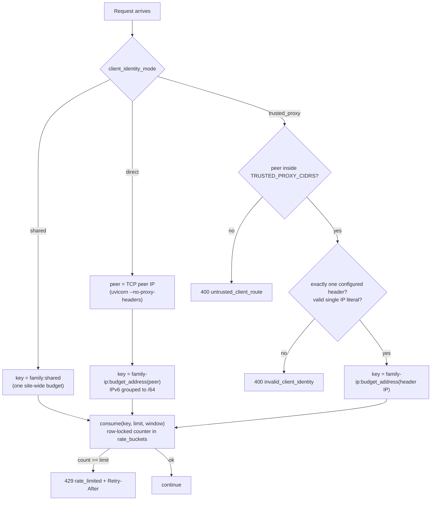

# 02 — Rate-limit identity

## In one sentence

Before M2O can say "this client has used up its budget", it has to decide who "this client" is, and it does that with one explicit, validated policy (`direct`, `trusted_proxy` or `shared`) instead of believing whatever IP a request claims in a forwarding header.

## The problem it solves

Rate limits (login attempts, recovery requests, visitor demo starts) are keyed by client identity. The obvious key is the client IP, and the obvious place to find it behind a proxy is `X-Forwarded-For`. Both go wrong:

- **Trusting `X-Forwarded-For` lets anyone pick their own identity.** The header is plain text the client can set. An attacker sends a new random value with every request and gets a fresh budget each time, so the login limit stops protecting anything. Worse, they can put a *victim's* IP in the header and use up the victim's budget, locking them out.
- **Ignoring headers behind a proxy merges everyone.** If the app sits behind a load balancer and keys by the TCP peer, every visitor appears to come from the proxy's IP. All users share one per-client budget. With M2O's default of 10 visitor starts per hour per client (`backend/app/settings.py:29`), the whole public demo would lock up after 10 starts.
- **IPv6 makes per-address keys useless.** A single home or cloud customer usually gets a whole /64 (2^64 addresses). Keying by full address lets one client rotate addresses and get unlimited budgets.

So the app needs a deliberate answer to "which IP do we believe?" that depends on how it is deployed, and it must fail safe when the deployment is misconfigured.

## Core flow



## Walk through the code

**1. The server never lets forwarding headers rewrite the peer address.** `backend/Dockerfile:13`

```dockerfile
CMD ["python", "-m", "uvicorn", "app.main:app", "--host", "0.0.0.0", "--port", "8000", "--no-access-log", "--no-proxy-headers"]
```

By default uvicorn can replace `request.client.host` with the value from `X-Forwarded-For` for trusted forwarders. M2O turns that off here, and the hosted launcher does the same (`backend/scripts/serve_demo.py:212`). So `request.client.host` is always the real TCP peer. The module docstring states the rule: "Explicit network identity for budgets; forwarding never changes auth or URLs" (`backend/app/client_identity.py:1`). Any header is read only by M2O's own code, only in `trusted_proxy` mode, and only for budget keys.

**2. Three modes, and only two headers allowed.** `backend/app/settings.py:41`

```python
    client_identity_mode: Literal["direct", "trusted_proxy", "shared"] = "direct"
    client_ip_header: Literal["x-m2o-client-ip", "cf-connecting-ip"] = "x-m2o-client-ip"
    trusted_proxy_cidrs: str = Field(default="", max_length=2048)
```

- `direct`: the app is reached directly (or via a proxy that preserves the peer); key by TCP peer.
- `trusted_proxy`: a known proxy sets one specific header; believe it only when the request really came from that proxy.
- `shared`: we can't identify clients reliably, so admit that and use one site-wide budget.

The header is a `Literal`, so `x-forwarded-for` is not even a legal setting; `backend/tests/test_client_identity.py:128` checks that it is rejected. The two allowed headers are meant to carry a single value that the proxy sets, replacing whatever the client sent. `X-Forwarded-For` is different: proxies append to it, so a client-supplied value can survive at the front of the list. Whether a given proxy really overwrites the header is a fact about the deployment, not the code, which is why `render.yaml` (step 8) asks for a hosted test before trusting it.

**3. Shared and direct are the simple paths.** `backend/app/client_identity.py:38`

```python
def budget_key(request: Request, family: str) -> str:
    prefix = family + "-ip" if family in {"login", "visitor"} else family
    if settings.client_identity_mode == "shared":
        return family + ":shared"
    try:
        peer = canonical_ip(request.client.host if request.client else "")
```

In `shared` mode every request in a family (`login`, `visitor`, `recovery-request`, ...) maps to one key and no header is looked at. In `direct` mode the key is the peer's budget address (`backend/app/client_identity.py:46`), or `unknown` if the peer can't be parsed. `backend/tests/test_client_identity.py:32` sends forged `cf-connecting-ip` and `x-forwarded-for` headers and shows both modes ignore them.

**4. Trusted proxy: check who is talking before reading the header.** `backend/app/client_identity.py:48`

```python
    if peer is None or not any(peer in network for network in trusted_networks(settings.trusted_proxy_cidrs)):
        raise ServiceError(
            status_code=400,
            error="Request arrived through an untrusted route",
            where="client",
            extra={"code": "untrusted_client_route"},
```

The header is only meaningful if the request came through the proxy that sets it. If someone reaches the app directly (bypassing the proxy), they could set the header to anything, so the request is rejected with `untrusted_client_route` instead of being trusted or silently falling back to the peer.

**5. Exactly one header, holding exactly one IP literal.** `backend/app/client_identity.py:55`

```python
    values = request.headers.getlist(settings.client_ip_header)
    try:
        if len(values) != 1:
            raise ValueError("Exactly one client identity header is required")
        client = canonical_ip(values[0])
```

Zero headers means the proxy didn't do its job. Two headers means someone else added one, and you can't tell which is real (`backend/tests/test_client_identity.py:73` sends the same header twice with different case). Both are rejected. `canonical_ip` (`backend/app/client_identity.py:12`) refuses empty strings, values over 64 chars, surrounding whitespace, zone IDs (`%eth0`), lists and ports, and maps IPv4-mapped IPv6 (`::ffff:203.0.113.1`) to the plain IPv4 address so the same client can't get two budgets by writing its address two ways. The parametrized cases are at `backend/tests/test_client_identity.py:49`.

**6. IPv6 is budgeted per /64.** `backend/app/client_identity.py:21`

```python
def budget_address(address: IPv4Address | IPv6Address) -> str:
    # One IPv6 subscriber usually holds a whole /64; per-address keys would let it rotate budgets.
    if isinstance(address, IPv6Address):
        return str(ip_network((address, 64), strict=False))
    return str(address)
```

Two addresses in the same /64 share a key; a neighbouring /64 gets its own. IPv4 stays per-address. The test at `backend/tests/test_client_identity.py:95` checks this in both `direct` and `trusted_proxy` modes, e.g. `2001:db8:1:2::1` → `visitor-ip:2001:db8:1:2::/64`.

**7. Configuration that would trust everyone is rejected at startup.** `backend/app/settings.py:85`

```python
            try:
                network = ip_network(part.strip(), strict=True)
            except ValueError:
                raise ValueError("Trusted proxies require explicit IP addresses or canonical CIDRs") from None
            if network.prefixlen == 0:
                raise ValueError("Trust-all proxy networks are forbidden")
```

`0.0.0.0/0` or `::/0` would mean "any peer is a trusted proxy", which is the same as trusting the header from anyone. `strict=True` also rejects non-canonical CIDRs like `192.0.2.1/24` (host bits set), which usually signal a typo. The model validator at `backend/app/settings.py:95` adds two rules: `trusted_proxy` mode needs at least one CIDR, and CIDRs without `trusted_proxy` mode are an error (a sign the operator thinks proxy trust is on when it isn't). Tests: `backend/tests/test_client_identity.py:122`. Because these are settings validators, a bad config stops the process from starting instead of failing open at request time.

**8. Shared mode gets its own, larger, site-wide limit; the counter is row-locked.** `backend/app/client_identity.py:28`

```python
def budget_limit(per_client: int, shared: int) -> int:
    """Shared mode pools every visitor into one key, so it needs a site-wide limit."""
    return shared if settings.client_identity_mode == "shared" else per_client
```

The visitor start route uses it at `backend/app/main.py:344`: `consume(budget_key(request, "visitor"), budget_limit(settings.visitor_start_limit, settings.shared_visitor_start_limit), 3600)`. Defaults are 10 per client and 150 site-wide per hour (`backend/app/settings.py:29`, `backend/app/settings.py:30`). Render runs in shared mode, and `render.yaml:31` gives the reason:

```yaml
      # One site-wide admission budget: Render publishes no inbound proxy ranges to trust.
      # Switch to trusted_proxy only after a hosted test proves CF-Connecting-IP is overwritten.
      - key: CLIENT_IDENTITY_MODE
        value: shared
```

Without known proxy ranges, `trusted_proxy` can't be configured safely, and `direct` would key everyone by Render's proxy IP with only 10 starts. Shared mode states the real situation and sizes the limit for it. The hosted launcher refuses to start unless the mode is explicitly `trusted_proxy` or `shared` (`backend/scripts/serve_demo.py:72`).

The counter itself is `consume` (`backend/app/limits.py:28`): a fixed-window counter in the `rate_buckets` table, keyed by a hash of the budget key, read with `FOR UPDATE` (`backend/app/limits.py:56`) so concurrent requests in different processes can't both pass the last slot. `backend/tests/test_client_identity.py:195` races two real processes on PostgreSQL and expects exactly one 200 and one 429.

## What breaks without each piece

| Mechanism | Failure it prevents |
| --- | --- |
| `--no-proxy-headers` | uvicorn rewrites the peer from a client-controlled header; every downstream use of the IP becomes spoofable. |
| Header limited to `x-m2o-client-ip` / `cf-connecting-ip` | Operator picks `X-Forwarded-For`, whose first entry the client controls. |
| Peer must be in `TRUSTED_PROXY_CIDRS` | Client bypasses the proxy, sets the header directly and picks any identity. |
| Exactly one header | Client adds its own copy next to the proxy's; app reads the forged one. |
| `canonical_ip` validation | Same client gets several budgets by formatting its address differently, or garbage values create junk keys. |
| IPv6 /64 grouping | One IPv6 subscriber rotates through its /64 for unlimited budgets. |
| Trust-all CIDR rejected | `0.0.0.0/0` silently turns header trust on for the whole internet. |
| Mode/CIDR consistency validator | Operator believes proxy trust is on (or off) when it isn't. |
| Shared mode + `shared_visitor_start_limit` | Behind an unknown proxy, everyone shares a 10/hour budget and the demo locks up. |
| `FOR UPDATE` on `rate_buckets` | Two processes both read count 9 of 10 and both pass. |

## Trade-offs and alternatives

**Why not just trust `X-Forwarded-For`?** Because the client controls its first entry, and the only safe way to use it is to know exactly how many trusted proxies appended to it and take the entry just before them. That depends on infrastructure the app can't see, and it breaks silently when the infrastructure changes. M2O instead needs one overwritten header from a peer it can verify.

**Shared mode's cost.** One noisy client can use up the site-wide budget and block everyone else. That is a denial-of-service risk accepted for a free synthetic demo. Note that `budget_limit` is only used for visitor starts. Other families keep their per-client limits even in shared mode, for example login at 30 per 5 minutes (`backend/app/main.py:253`) and recovery requests at 10 (`backend/app/lifecycle_routes.py:109`), so in shared mode those become site-wide budgets of that size. Login also has a separate per-account budget (`backend/app/main.py:254`). For a real private deployment you'd want `trusted_proxy` behind a proxy that publishes ranges (or your own gateway), or an edge rate limiter (Cloudflare, API gateway) in front.

**Database counters vs Redis.** A Postgres row per key is consistent across processes and needs no extra service, at the cost of a write per limited request. Redis `INCR` with TTL is faster and the usual choice at scale. The fixed window is simple but lets a client burst up to twice the limit across a window boundary; a sliding window or token bucket smooths that.

**When to change thresholds.** 150 visitor starts/hour site-wide and 10 per client are policy, not measured capacity (`docs/USER_LIFECYCLE.md:11` says quotas "are not a measured load-capacity claim"). You would raise the shared limit if legitimate traffic hits 429s, lower it if storage or worker load climbs, and switch to `trusted_proxy` once a hosted test proves the proxy overwrites the header, which is exactly what the `render.yaml` comment asks for. /64 grouping could be widened (/56, /48) if abuse comes from larger allocations, at the cost of merging more innocent neighbours.

## Interview questions

**1. Why is `X-Forwarded-For` not a safe source of the client IP?**

<details><summary>Answer</summary>

It is a request header the client can set. Proxies append to it rather than replace it, so whatever the client sent is still at the front of the list. If you key a rate limit on it, an attacker changes it every request to get unlimited budgets, or sets it to a victim's IP to lock the victim out. You can only use it if you know exactly which trailing entries came from your own trusted proxies.
</details>

**2. What are M2O's three identity modes, and when would you use each?**

<details><summary>Answer</summary>

`direct`: the TCP peer is the real client (local Compose, or a proxy that preserves source IPs); key by peer. `trusted_proxy`: a known proxy with known IP ranges sets a single overwritten header (`cf-connecting-ip` or `x-m2o-client-ip`); believe it only from those ranges. `shared`: you can't identify clients reliably (Render, which publishes no inbound proxy ranges), so use one site-wide budget with a larger limit.
</details>

**3. In trusted-proxy mode, why reject requests with two identity headers instead of taking the first or last?**

<details><summary>Answer</summary>

Two headers mean something other than the trusted proxy added one, and there is no reliable rule for which is real; it depends on how the proxy handles existing headers. Picking either could hand the client control. Rejecting with 400 `invalid_client_identity` fails closed and surfaces the misconfiguration. Duplicate header names differing only in case count as the same header (`backend/tests/test_client_identity.py:73`).
</details>

**4. Why group IPv6 addresses by /64 but not IPv4 by /24?**

<details><summary>Answer</summary>

An IPv6 subscriber typically gets a whole /64, and devices change addresses inside it freely (privacy addresses), so per-address keys let one client rotate endlessly. A /64 is roughly "one customer". IPv4 addresses are scarce; one address is already roughly one customer or one NAT. Grouping IPv4 by /24 would merge up to 256 unrelated customers. The comment at `backend/app/client_identity.py:22` gives the IPv6 reasoning.
</details>

**5. The trusted proxy list is validated at startup. What exactly does it reject, and why is startup the right place?**

<details><summary>Answer</summary>

It rejects anything that isn't an IP or canonical CIDR (`strict=True` refuses host bits like `192.0.2.1/24`), empty entries (`192.0.2.1,,192.0.2.2`), and any network with prefix length 0 (`0.0.0.0/0`, `::/0`). The model validator also requires CIDRs in `trusted_proxy` mode and forbids them in other modes. At startup, a misconfiguration stops the process and shows up in deploy logs. At request time it would either fail open (trust everyone) or fail every request in production.
</details>

**6. Render's demo is in shared mode with 150 visitor starts per hour. Describe an attack this allows and how you'd harden it without trusting forged headers.**

<details><summary>Answer</summary>

One client can make 150 start requests in an hour and lock every other visitor out until the window resets; in shared mode the login and recovery families are also site-wide (30 and 10 per 5 minutes), so one client can block those too. Hardening options: put a proxy or CDN you control in front (e.g. Cloudflare) that publishes its ranges and overwrites `CF-Connecting-IP`, then run `trusted_proxy` with those CIDRs after proving in a hosted test that the header is overwritten; add an edge rate limiter or bot check; or add a proof-of-work/CAPTCHA on visitor start. Each one replaces "we can't tell clients apart" with a verified identity, so per-client limits work again.
</details>

## Explain it back

1. Explain to a teammate why "just read `X-Forwarded-For`" is wrong, and what conditions make a forwarded header trustworthy.
2. Walk through what happens to a request in each of the three modes, and say which failure each mode accepts.
3. Argue for or against keeping the hosted demo in shared mode, using the comment in `render.yaml` and the limits in `settings.py`.
