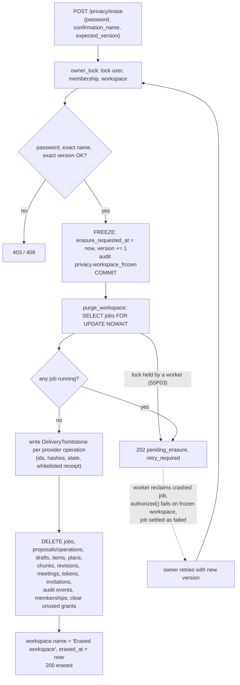

# 04 — Workspace erasure flow

## In one sentence

Erasing a workspace is two steps: first commit a "freeze" that revokes all authority over the workspace, then purge its data only once no worker is still running a job for it; delivery receipts that might describe a real external effect survive as small content-free tombstones until an operator resolves them.

## The problem it solves

A workspace owner asks M2O to delete everything: transcripts, embeddings, outcomes, plans, drafts, jobs, audit details. The naive version, "`DELETE` all rows for this workspace in one transaction", fails in several ways:

- **A worker is mid-job.** An extraction job read the transcript a minute ago and is about to write outcomes. If you delete under it, it either crashes on missing rows or, worse, writes new rows into a workspace you just erased. If it's a publish job, it may be about to send content to GitHub, Jira, Slack or LinkedIn after the owner asked for erasure.
- **Waiting on the worker while holding locks.** If the erasure transaction locks the owner's account and workspace and then waits for the worker's job row lock, and the worker is in the middle of a provider HTTP call that holds that job row lock, the request hangs and everything else that needs those locks hangs with it.
- **You'd forget that something happened outside.** If a Jira issue may or may not have been created (an "uncertain" write, see guide 01), deleting the local record means nobody can ever reconcile it. The external effect still exists, but the only evidence is gone.
- **A crashed worker blocks forever.** If erasure waits for running jobs, and a worker died leaving a `running` row, erasure waits until someone reclaims that row.
- **Cleanup races with renewal.** A maintenance job that selects "expired" rows and then deletes them later can delete a row that was renewed in between.

## Core flow



## Walk through the code

**1. Freeze first, and commit the freeze before doing anything slow.** `backend/app/services/privacy.py:339`

```python
        if workspace.erasure_requested_at is None:
            workspace.erasure_requested_at, workspace.version = now(), workspace.version + 1
            audit(self.session, principal, "privacy.workspace_frozen", workspace.id)
        workspace_id = workspace.id
        # Workers observe revoked scope before any cleanup waits for their job rows.
        self.session.commit()
```

Before this, `owner_lock` (`backend/app/services/lifecycle.py:31`) row-locks the user, membership and workspace and requires an active owner; `reauthenticate` checks the password; and the request must name the workspace exactly and give its current `version` (`backend/app/services/privacy.py:333`). The version check stops an erasure confirmed against stale information. Then `erasure_requested_at` is set and the transaction **commits**, releasing those row locks. The `if` makes the call idempotent: a retry doesn't refreeze or bump the version again.

**2. The freeze revokes authority everywhere at once.** `backend/app/access_policy.py:29`

```python
def workspace_is_active(workspace: Workspace | None) -> bool:
    return bool(
        workspace
        and workspace.erasure_requested_at is None
        and workspace.erased_at is None
```

Every request path and every worker step goes through `workspace_access` (`backend/app/access_policy.py:55`), which returns 404 for an inactive workspace. So once the freeze commits, the API stops serving the workspace's meetings, and a worker's next `authorized()` call (guide 01, step 6) fails with `service_404` before any further side effect. The owner can still call `GET /privacy` because `workspace_status` (`backend/app/services/privacy.py:304`) deliberately does not use `workspace_is_active`; it reports `pending_erasure`. `backend/tests/test_privacy.py:226` checks that meetings return 404 while status still works.

**3. Try to take every job row, but don't wait.** `backend/app/services/privacy.py:354`

```python
            jobs = self.session.scalars(
                select(Job)
                .where(Job.workspace_id == workspace_id)
                .order_by(Job.id)
                .with_for_update(nowait=True)
                .execution_options(populate_existing=True)
```

A worker holds its job row locked while it works on it: every `owned_job` call takes `FOR UPDATE`, and the GitHub publish path keeps that transaction open across the HTTP request (`backend/app/worker.py:193`). `NOWAIT` makes Postgres fail immediately with SQLSTATE `55P03` (lock not available) instead of blocking. The code catches exactly that code, rolls back, and returns `pending_erasure` with `retry_required: True` (`backend/app/services/privacy.py:361`). Any other database error is re-raised. Locking in `Job.id` order gives a consistent lock order between concurrent purges.

**4. Wait for running jobs to settle.** `backend/app/services/privacy.py:372`

```python
        if any(job.state == "running" for job in jobs):
            return {
                "ok": True,
                "state": "pending_erasure",
                "workspace_id": workspace_id,
                "retry_required": True,
```

Even if no worker holds a lock at this instant, a `running` job means a worker may be between steps (for example, waiting on a model or provider). Erasing under it would race with its next write. So purge refuses and the route turns this into HTTP 202 (`backend/app/lifecycle_routes.py:194`). The owner retries with the new `version` from `GET /privacy`. Queued jobs don't block purge; they are simply deleted later, and a queued job that a worker claims after the freeze fails `authorized()` anyway.

This check doesn't look at `lease_until`. A `running` job with an expired or missing lease still blocks erasure, and it is the worker's recovery that unblocks it. This is the interaction the crash drill tests (`backend/tests/test_privacy.py:239`): the worker reclaims the dead job, `authorized()` fails because of the freeze, the job is settled as `failed`/`service_404`, and the retried erasure completes. Before the NULL-lease fix, a `running` row with no lease was never reclaimed, so erasure for that workspace stayed `pending_erasure` forever.

**5. Keep a minimal tombstone for every delivery.** `backend/app/services/privacy.py:410`

```python
                    self.session.add(
                        DeliveryTombstone(
                            workspace_id=workspace_id,
                            provider=provider,
                            operation_id=operation.id,
                            delivery_key=key,
```

For each GitHub/Jira/Slack/LinkedIn operation, purge writes a `DeliveryTombstone` with the operation ID, delivery key, payload hash, state and a `minimal_receipt` (`backend/app/services/privacy.py:70`), which keeps only whitelisted keys like `status`, `id`, `key`, `message_ts` (`backend/app/services/privacy.py:67`) with short string/int values. No bodies, transcript text or error messages. Retention starts at `privacy_tombstone_days` (default 90, `backend/app/settings.py:33`). The point: if an operation was `uncertain`, someone may still need to find and reconcile the remote effect, and the hashes let them match it without keeping the content. `backend/tests/test_privacy.py:199` checks the tombstone is `uncertain`, keeps the hashes, and contains none of the private text.

**6. Delete the content, including audit events, and mark the workspace erased.** `backend/app/services/privacy.py:509`

```python
        self.session.execute(delete(Invitation).where(Invitation.workspace_id == workspace_id))
        self.session.execute(delete(AuditEvent).where(AuditEvent.workspace_id == workspace_id))
        self.session.execute(delete(Membership).where(Membership.workspace_id == workspace_id))
        workspace.name, workspace.erased_at = "Erased workspace", now()
        workspace.version += 1
```

The deletes run children-first (jobs, operations, proposals, drafts, plans, review history, evidence, items, chunks, revisions, meetings, ...) from `backend/app/services/privacy.py:423` onward. Provider grants used by this workspace have their ciphertext cleared, unless another active workspace still uses them (`backend/app/services/privacy.py:497`). The workspace row survives with an opaque ID, its timestamps and the name `Erased workspace`.

Note what happens to **audit history**: the workspace's `AuditEvent` rows are deleted, including the `privacy.workspace_frozen` event written in step 1. The code gives no comment on why; the likely reason is that audit details and target IDs describe the erased content. `docs/USER_LIFECYCLE.md:64` lists "raw audit details" among the erased data, and `backend/tests/test_privacy.py:198` asserts no `AuditEvent` rows remain. Audit history is available *before* erasure through the owner's workspace export (`backend/app/services/privacy.py:258`), which filters `details` to a small whitelist of keys. After erasure, what remains as evidence is the workspace's `erasure_requested_at`/`erased_at` timestamps and the tombstones.

**7. Retention maintenance: preview by default, recheck on apply.** `backend/app/services/retention.py:98`

```python
        if not apply:
            return report
```

`scripts/privacy_retention.py` runs `RetentionService.run`, which first only *counts* expired visitors, eligible tombstones and expired temporary records (sessions, tokens, rate buckets, OAuth states, ...) in batches of at most `limit` per class (1-100). Without `--apply` it returns that report and changes nothing. With `--apply`, every deletion re-checks its condition at the moment it happens. Visitors are re-read under `FOR UPDATE` and skipped if their expiry moved (`backend/app/services/retention.py:109`). Temporary records are deleted with `expires_at <= cutoff` repeated in the `DELETE` (`backend/app/services/retention.py:176`):

```python
        # Recheck expiry in DELETE: a quota may have been renewed since selection.
        # Cascade/purge removals are intentionally distinct from direct removals.
        for model, key in TEMPORARY_RECORDS:
            identifiers = temporary[model.__tablename__]
            if identifiers:
                result = self.session.execute(
```

`backend/tests/test_retention.py:197` renews a rate bucket between selection and delete and proves it survives. Expired visitors go through the same freeze-then-purge path as an owner's erasure (`backend/app/services/retention.py:136`), and if a purge returns `pending_erasure` the visitor is kept for a later run.

**8. Uncertain tombstones need an explicit human decision.** `backend/app/services/retention.py:66`

```python
        tombstones = self.session.scalars(
            select(DeliveryTombstone)
            .where(
                DeliveryTombstone.retained_until <= cutoff,
                DeliveryTombstone.state.not_in({"uncertain", "sending"}),
            )
```

Tombstones in `uncertain` or `sending` are never auto-deleted, however old. An operator inspects the remote system and records `confirmed`, `not_sent` or `accepted_unknown` via `resolve_tombstone` (`backend/app/services/retention.py:190`); the CLI requires typing the exact ID to apply (`backend/scripts/privacy_retention.py:23`). That sets the state to `resolved`, stores the decision with a timestamp in the receipt, and starts a fresh retention period. Diagnostics surface what is stuck: `unresolved_tombstones`, `pending_erasure_workspaces`, `expired_running_leases` and `running_without_lease` (`backend/app/services/diagnostics.py:88`, `backend/app/services/diagnostics.py:95`, `backend/app/services/diagnostics.py:105`).

`backend/tests/test_retention.py:240` ties it all together: a publish job crashed mid-send in a frozen workspace. Purge waits; the worker reclaims the job (or, at three attempts, settles it in `claim`) without calling the provider; the operation stays `uncertain`; purge completes; and retention refuses to delete the uncertain tombstone.

## What breaks without each piece

| Mechanism | Failure it prevents |
| --- | --- |
| Name + version + password confirmation | Erasing the wrong workspace, or one that changed since the owner looked. |
| Freeze committed before purge | Workers and API requests keep acting on the workspace while cleanup waits; purge holds owner locks while blocked on a worker. |
| `workspace_is_active` checks `erasure_requested_at` | A frozen workspace is still readable/writable through some path. |
| `FOR UPDATE NOWAIT` + `55P03` handling | The erase request hangs behind a worker's provider call. |
| Refuse while a job is `running` | A worker writes new rows into, or publishes from, a workspace being deleted. |
| Worker reclaim of expired/NULL leases | A crashed job keeps erasure `pending_erasure` forever. |
| Tombstones with hashes and whitelisted receipt | Evidence of a possible remote effect is lost, or private content is retained in the "minimal" record. |
| Uncertain/sending tombstones excluded from auto-delete | Retention silently forgets an unresolved external effect after 90 days. |
| Preview-by-default retention | An operator deletes data without seeing what would go. |
| Expiry rechecked in the `DELETE` / under row lock | A record renewed after selection is deleted anyway. |

## Trade-offs and alternatives

**Two-phase (freeze, then purge) vs one transaction.** One transaction is simpler but has to wait for workers while holding locks, and any failure rolls back the freeze too. Two phases make the important part (nobody can act any more) fast and durable, and make the slow part retryable. The cost is a visible intermediate state, `pending_erasure`, that the UI and owner must handle, and the owner must retry.

**Owner retries vs background purge.** Today a retry is driven by the owner (or the next retention run for visitors). A background sweeper that retries pending erasures would remove that burden, at the cost of one more scheduled process. `docs/USER_LIFECYCLE.md:86` notes that retention is an operator command, "not a claimed scheduled task".

**Hard delete vs soft delete.** M2O hard-deletes local content, which is what erasure promises. Soft delete (a `deleted_at` flag) is easier to undo but keeps the data and requires every query to filter it. The tombstone is a deliberate, tiny exception justified by the uncertain-write problem.

**Deleting audit events.** Erasing audit rows protects privacy but removes the in-database record of who did what, including who requested the erasure. An alternative is to keep a separate, content-free erasure log (actor, timestamp, workspace ID) outside the workspace's audit table. Backups are a separate gap: `docs/USER_LIFECYCLE.md:98` says local erasure does not rewrite existing backups.

**Thresholds.** The 90-day tombstone retention (`privacy_tombstone_days`, 1-365) and the 2,000,000-character browser export cap (`backend/app/services/privacy.py:161`) are policy choices. You'd lengthen retention if provider reconciliation routinely takes longer; you'd raise the export cap only with streaming export, since today the whole export is built in memory.

## Interview questions

**1. Why does erasure return 202 sometimes instead of 200?**

<details><summary>Answer</summary>

202 means "accepted, not finished": the workspace is frozen, but purge found a job row locked by a worker (`55P03` from `NOWAIT`) or a job in `running` state. Deleting now would race with that worker. The response says `pending_erasure` and `retry_required: true`; the owner retries with the new version once the worker settles.
</details>

**2. What is the "freeze", and why is it committed before the purge?**

<details><summary>Answer</summary>

The freeze sets `workspace.erasure_requested_at` and bumps `version`. Every access check (`workspace_is_active`) treats that as inactive, so API requests and worker `authorized()` checks fail from then on. It's committed first so workers can see it (they read committed data) and so the erase request releases its locks on the owner, membership and workspace before it tries to lock job rows that a worker might hold. Otherwise the request could wait on the worker while blocking anything else that needs the owner's locks.
</details>

**3. Why use `FOR UPDATE NOWAIT` on job rows instead of plain `FOR UPDATE`?**

<details><summary>Answer</summary>

A worker can hold its job row lock for a long time, for example across a GitHub HTTP request. Plain `FOR UPDATE` would block the erase HTTP request until that finishes, tying up a request thread and a pooled connection. `NOWAIT` fails immediately with `55P03`, which the code treats as "a worker is busy, come back later" and returns 202.
</details>

**4. A worker crashed mid-extraction an hour ago, leaving a `running` job. The owner requests erasure. Walk through what happens.**

<details><summary>Answer</summary>

The freeze commits. Purge locks the job rows (no worker holds them) but sees `running`, so it returns 202. When a worker next polls, `claim` finds the row: `running` with an expired lease (or a NULL lease, after the fix). It reclaims it with a new token. `execute` calls `authorized`, which calls `workspace_access`, which fails with 404 because the workspace is frozen. `run_once` records `failed`/`service_404` with a NULL lease. The owner retries; purge finds no running jobs and erases. If the job had already used three attempts, `claim` would mark it `failed`/`attempt_limit` directly. If no worker is running at all, erasure stays pending, and diagnostics would show it in `pending_erasure_workspaces` and `expired_running_leases`.
</details>

**5. What is a delivery tombstone, what does it contain, and why is it not deleted with everything else?**

<details><summary>Answer</summary>

It is a row kept after erasure for each provider operation: provider, operation ID, delivery key, payload hash, state, a receipt reduced to whitelisted short fields (IDs, keys, timestamps, status), and `retained_until`. It has no content. It exists because a delivery may have created something outside M2O, especially an `uncertain` one where we don't know. Keeping the identifiers and hashes lets an operator reconcile the remote effect later. Known outcomes are kept for at least 90 days; uncertain or sending ones are kept until an operator resolves them.
</details>

**6. The retention job selects expired rows and then deletes them. What race does that create, and how does M2O handle it? How would you design a scheduled version?**

<details><summary>Answer</summary>

Between selecting and deleting, a row can be renewed (a rate bucket reset, a visitor extended). Deleting by ID alone would remove a live row. M2O repeats the condition in the `DELETE` (`expires_at <= cutoff`, and for tombstones `retained_until <= cutoff` and state not uncertain/sending), and re-reads visitors under `FOR UPDATE` before purging them; the test renews a bucket mid-run and checks it survives. A scheduled version would run the same bounded batches on a timer, use a session advisory lock (as in guide 03) so only one instance runs at a time, keep the preview report as a log/metric, and alert when `unresolved_tombstones` or `pending_erasure_workspaces` stay non-zero for too long.
</details>

## Explain it back

1. Explain freeze-then-purge to a non-engineer stakeholder: what the owner sees, why it might say "pending", and what guarantees they have at each moment.
2. Explain how the worker's lease recovery (guide 01) and workspace erasure depend on each other, and what would happen if either were missing.
3. Defend the decision to delete audit events on erasure while keeping tombstones, and propose what you would keep instead if an auditor asked "who erased this workspace and when?"
