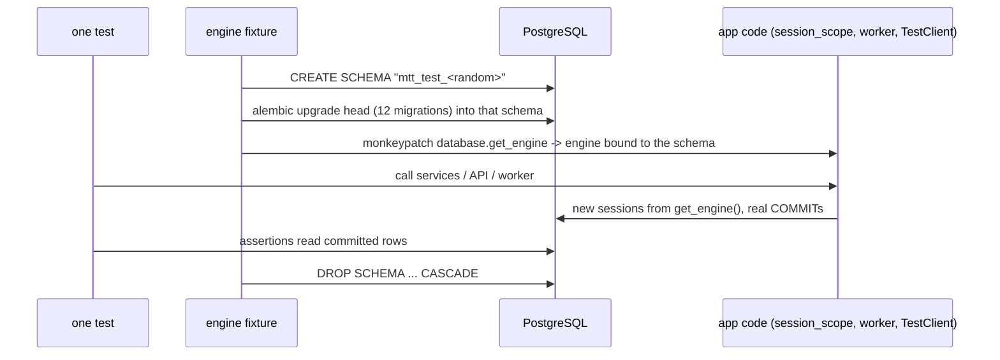

# 05 — Test database isolation and speed

## In one sentence

Every backend test gets its own freshly migrated PostgreSQL schema: `backend/tests/conftest.py` creates a random schema, runs all Alembic migrations into it, points the app at it and drops it afterwards. That makes tests completely independent, and it is also where most of the PostgreSQL suite's time is likely spent.

## The problem it solves (and the one it creates)

Tests that share a database leak into each other. Test A inserts a user, test B counts users and gets the wrong number, and B passes or fails depending on which tests ran first. The bug only appears in CI, or only on Tuesdays. The per-test schema removes that whole class of problem: nothing a test writes survives it.

The cost is setup time. Each of the ~535 tests runs `CREATE SCHEMA`, 12 migrations and `DROP SCHEMA ... CASCADE` before and after its own work. Measured numbers so far (October 18, 2026):

| Where | `pytest -q --postgres` | Note |
| --- | --- | --- |
| GitHub Actions, Ubuntu, PostgreSQL 17 service container | 292 s (about 4.9 min) | The `pytest` step of the `backend` job |
| Windows 11 laptop, PostgreSQL 17 in Docker Desktop | 535 s (530 tests, `main` at `e66053d`, 2026-10-19) | An earlier run measured 677 s on the worker-fix branch (535 tests); the gap was not investigated |

Both are measurements of different environments. On the laptop, `--durations=40` showed almost every slow phase was `setup` at 1.2–2.0 s, which confirmed the per-test migration as the cost before any code changed. After the change described below (migrate once, TRUNCATE after each test), the same laptop run took 227 s with identical results.

## Core flow (today)



## Walk through the code

**1. A schema per test.** `backend/tests/conftest.py:35`

The `engine` fixture has no `scope=`, so pytest runs it once per test (function scope). With `--postgres` it creates a randomly named schema (line 41) and builds a second engine whose connections set `search_path` to it, so every unqualified table name resolves inside that schema.

**2. Real migrations, not `create_all`.** `backend/tests/conftest.py:50`

```python
with engine.begin() as connection:
    config = Config(str(Path(__file__).resolve().parents[1] / "alembic.ini"))
    config.attributes["connection"] = connection
    command.upgrade(config, "head")
```

On PostgreSQL the tests run the same migrations production runs, so a broken migration fails the suite. SQLite uses `Base.metadata.create_all` instead and writes `alembic_version` by hand, which is why SQLite runs can't prove migration or row-lock behavior.

**3. The app is pointed at the test schema.** `backend/tests/conftest.py:72`

`monkeypatch.setattr(database, "get_engine", lambda: engine)`. Application code never receives a session from the test. It calls `session_scope()` (`backend/app/database.py:46`), which opens **its own** session from `get_engine()` and **commits**. The worker does the same, sometimes inside `asyncio.to_thread`, and `TestClient` serves requests on another thread. This fact decides which speed-up patterns work here (see trade-offs).

**4. Some tests need two real connections at once.** `backend/tests/test_concurrency.py:16`

Two threads meet at a `Barrier` and claim jobs at the same moment, which proves `FOR UPDATE SKIP LOCKED` hands them different rows. Other tests take advisory locks or create their own schemas (`backend/tests/test_phase8_runtime.py`). These only mean something with separate connections and real commits.

**5. Cleanup.** `backend/tests/conftest.py:83`

`DROP SCHEMA ... CASCADE` removes everything the test made.

## What breaks without each piece

| Piece | Failure it prevents |
| --- | --- |
| Fresh schema per test | Order-dependent tests: one test's rows change another's result |
| Real migrations on PostgreSQL | A migration that fails in production but passes in tests |
| `get_engine` monkeypatch | App code writing to the developer's real database |
| Real commits through `session_scope` | Tests that pass in a transaction that production never uses (commit-time constraints, visibility between connections) |
| Separate connections in concurrency tests | A "proof" of `SKIP LOCKED` that never had two lockers |

## Trade-offs and alternatives

There are four standard ways to make this faster. Earlier I suggested the first one as "the common fix"; looking at how this codebase opens sessions, it is the riskiest fit here. Checking that a pattern matches the code before adopting it is part of the job.

| Approach | How | Fits M2O? |
| --- | --- | --- |
| **A. Transaction rollback per test** | Migrate once per session. Each test runs inside one outer transaction on one connection, using SAVEPOINTs so code can still "commit"; roll back at the end. SQLAlchemy documents this as joining a Session into an external transaction (`join_transaction_mode="create_savepoint"`). | **Poor.** App code opens its own sessions from `get_engine()` and commits; the worker and `TestClient` use other threads. Everything would have to share one connection, which breaks the concurrency tests and changes what "committed" means. |
| **B. Migrate once, TRUNCATE after each test** | Session-scoped fixture migrates one schema; after each test, `TRUNCATE` every table except `alembic_version`. This is how Django's `TransactionTestCase` resets. | **Good.** Keeps real commits and multiple connections. Cost: one TRUNCATE of every table per test. |
| **C. Template database** | Migrate once into a template database; each test runs `CREATE DATABASE ... TEMPLATE` (a file copy). | Possible. Needs `CREATEDB` permission and works per database, not per schema, so the fixture changes more. |
| **D. Run tests in parallel (pytest-xdist)** | Several worker processes, each with its own schema. | Complementary. Cuts wall-clock time without changing isolation; can be combined with B. |

Traps in approach B:

- **Never truncate `alembic_version`.** The schema guard (`backend/app/schema_compatibility.py`) reads it; an empty table makes the API refuse to start.
- **Some tests must keep the slow path:** the concurrency tests, the migration tests that create their own schemas, and anything that runs `migrate.main()`. Give them an opt-out marker, for example `@pytest.mark.fresh_schema`.
- **Monkeypatched settings stay function-scoped.** Only the schema and migration become session-scoped; `settings` changes must still be undone after each test.
- **Prove isolation, not just speed:** run the suite in two different orders (for example with `pytest-randomly`, or `-p no:randomly` versus reversed file order) and get the same results.

## The work, in order

1. **Measure.** `pytest -q --postgres --durations=30` lists the slowest setup, call and teardown phases separately. Add up how much of the 292 s (CI) is `setup` of the `engine` fixture. If it is small, this whole project is the wrong fix, and that is a good finding.
2. **Write the plan in the issue:** chosen approach (probably B), tests that keep the slow path, and acceptance criteria.
3. **Branch** in VS Code (`test/session-scoped-postgres`), implement, keep the diff small.
4. **Verify:** same pass/skip counts as before on SQLite and PostgreSQL, the order check above, and timings before and after on both your laptop and CI.
5. **PR** with the numbers, the list of opted-out tests and why, and a note in `docs/VALIDATION.md` with the date and machine.

## Interview questions

**1. Why do tests that share a database become flaky?**

<details><summary>Answer</summary>

Because their result depends on state left by tests that ran earlier, and test order is not something the test controls. A test can pass alone and fail in the full suite, or fail only when CI happens to run files in a different order.
</details>

**2. What does pytest fixture scope mean, and which scope does `engine` use?**

<details><summary>Answer</summary>

Scope is how often pytest creates the fixture: `function` (default, once per test), `class`, `module`, `package` or `session` (once per run). `engine` has no `scope=` argument, so it is function-scoped: a new schema and full migration for every test.
</details>

**3. Why is the transaction-rollback pattern a poor fit for M2O?**

<details><summary>Answer</summary>

It only works when all database work in a test goes through the one connection holding the outer transaction. M2O's services and worker open their own sessions from `get_engine()` and commit, and the API and worker run on other threads. Forcing everything onto one connection would break the concurrency tests, which need two connections locking rows at the same time, and would hide commit-time behavior.
</details>

**4. You switched to TRUNCATE between tests and the suite got faster, but three tests now fail only when run after a particular file. What do you check?**

<details><summary>Answer</summary>

State that TRUNCATE doesn't reset: rows in a table that was left out of the list, sequences if any table uses them (`RESTART IDENTITY`), settings or module-level caches changed without monkeypatch (for example `lru_cache` on `get_engine`), and files on disk. Then confirm the failing tests don't rely on something the old per-test migration created.
</details>

**5. Your laptop takes 11 minutes and CI takes 5. Which number goes in the issue?**

<details><summary>Answer</summary>

Both, labeled with the environment, because they answer different questions: CI time costs every PR, the laptop time costs your feedback loop. Optimize against the one that hurts, and measure the effect on both.
</details>

## Explain it back

1. Draw the life of one test's schema, from `CREATE SCHEMA` to `DROP SCHEMA`, and mark where the time goes.
2. Explain to a teammate why "wrap each test in a transaction" is not a drop-in fix for this codebase.
3. Write the acceptance criteria you would put in the issue before writing any code.
